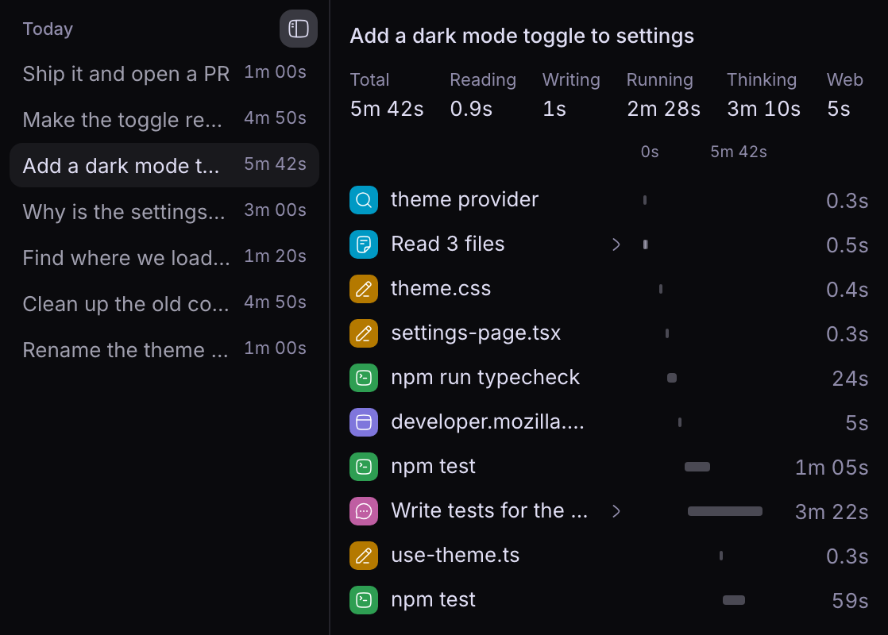

# Steps

See what a bb agent did and where its time went.

Steps adds a tab to the side panel of every bb thread. Pick one of your
messages on the left and its waterfall opens on the right: every file read,
command, edit, web fetch and subagent on one shared timeline.



## Install

```sh
bb plugin install git:https://github.com/sankalpaacharya/bb-steps.git@main
```

Then open a thread, open the right panel with Cmd+J, click **+** and choose
**Steps**. Requires bb 0.49 or later.

## Using it

- Click a message, or use the up and down arrow keys, to open its waterfall.
- Click a step to see its status, times, input and output.
- The top of each message shows its total time and how much went on reading,
  writing, running and thinking. The numbers tick while the agent works.
- Click one of those, such as **Reading**, to list only those steps. **Thinking**
  is hidden until you pick it.
- Threads a message started, such as a captain's workers, show on the same
  timeline. Click one to see its steps in place.
- Drag the sidebar's right edge to resize it, double-click the edge to reset it,
  and use the panel icon to collapse it.

bb does not keep the output of file reads or web fetches, so those steps show
their input only.

## Dev

```sh
npm install
npm run check
bb plugin install . --yes
```

`npm run check` runs the typecheck, the tests and the build.
