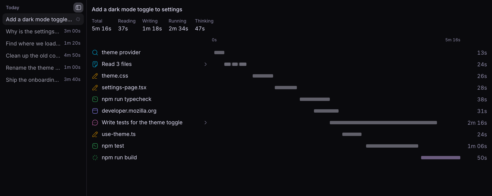

<p align="center">
  
</p>

<h1 align="center">Steps</h1>

<p align="center"><strong>See what your agent is doing now and where the time went, inside BB.</strong></p>

<p align="center">
  
  
</p>

<p align="center">
  
</p>

BB shows an agent's work as one long chat. Steps adds a side panel tab that shows what the agent is doing right now, and every file read, command, edit, web fetch and subagent behind it.

## Install

```sh
bb plugin install git:https://github.com/sankalpaacharya/bb-steps.git@main
```

Then open a thread, press **⌘J**, click **+**, and choose **Steps**. Requires BB 0.49+.

## What you get

- **Active**: every thread running now across bb, under its captain, with its running time. Pick one to inspect it here; the chat stays where it is
- The message that is running now, or the newest one, with the others one click away under **messages**
- **Now**: what the agent is doing right now, down to a subagent's current command
- Where the time went: one bar, with the three biggest totals
- Every step newest first, with its duration in grey, then amber past a minute and red past five
- Short thoughts and replies left out, and quick steps side by side folded into one row
- Input and output for each step, and **Open file** for files it touched
- Threads a message started, such as a captain's workers, opening in place, and **All threads** in the messages menu

Steps reads each chat's history from BB and stores no copy of it. The list keeps the newest 50 messages per chat, and older ones drop off. Your chat history in BB isn't touched.

BB doesn't keep the output of file reads or web fetches, so those steps show their input only.

## Dev

```sh
npm install
npm run check
bb plugin install . --yes
```

`npm run check` runs the typecheck, the tests and the build.
